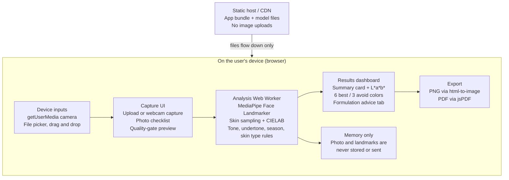
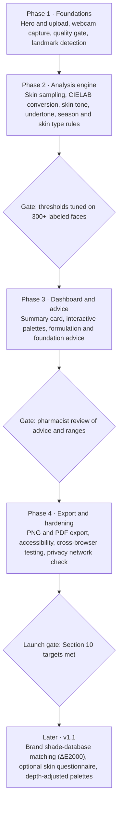

# SkinPalette PRD: AI Skin & Personal Color Analyzer

Date: 2026-11-15

## 1. Overview

SkinPalette is a browser-only web app that turns one selfie into a skin tone, undertone, skin type and personal color season report, with cosmetic formulation advice, and no photo ever leaves the user's device. The analysis engine is branded "DermaTone AI: Skin & Personal Color Analyzer".

**Problem.** Shoppers in pharmacies and cosmetic retail choose foundations, skincare textures and clothing colors by guesswork. In-store consultations vary by staff member, and cloud-based analyzers ask users to upload face photos to a server, which many will not accept.

**Vision.** A clean, clinical-cosmetic experience that gives a consistent, explainable result in under 10 seconds, using only on-device computer vision and color science.

**Goals**

1. Analyze a selfie fully client-side (landmarks, skin sampling, CIELAB conversion) and return results in under 5 seconds after capture on a mid-range phone.
2. Report skin tone, undertone, personal color season and estimated skin type with a visible confidence level.
3. Give a 6-color best palette, a 3-color avoid palette and pharmacist-style formulation advice for the detected skin type.
4. Let users export the result as a PNG or PDF summary card.

**Non-goals (v1)**

- No medical diagnosis, acne, rosacea, melanoma or other dermatological condition detection.
- No user accounts, server-side image storage or analytics that include image data.
- No e-commerce checkout or live shade-database matching (planned for a later release).

**Naming note.** This PRD uses SkinPalette as the product name and DermaTone AI as the analysis feature name; see Open Questions to confirm.

## 2. Target Users & User Stories

Three user groups drive the requirements: shoppers who want a quick self-assessment, pharmacy and beauty-counter staff who want a consistent consultation aid, and skincare enthusiasts who want to understand the reasoning behind a recommendation.

| Persona | Context | Core need |
| --- | --- | --- |
| Shopper | Phone, at home or in store | A fast, private answer to "which shades and skincare texture suit me?" |
| Pharmacist / beauty advisor | Tablet at the counter | A repeatable analysis to support a product conversation |
| Skincare enthusiast | Laptop with webcam | Transparent metrics (L\*, a\*, b\*) and ingredient rationale |

**User stories**

- As a shopper, I can take a selfie with my webcam or upload one, so I can get results without installing anything.
- As a shopper, I see a checklist (natural lighting, no heavy makeup, hair pulled back) before capture, so my result is reliable.
- As a privacy-conscious user, I can see that my photo is processed on my device only.
- As a user, I see my skin swatch hex, L\*a\*b\* values, skin tone, undertone, skin type and color season on one card.
- As a user, I can tap palette colors to see names, hex codes and where to use them (clothing, lips, eyes, cheeks).
- As a user, I can read emulsion-base and active-ingredient advice matched to my skin type, plus foundation undertone guidance.
- As a user, I can download my result card as an image or PDF to keep or show a pharmacist.

## 3. Hero Section & Upload Interface

The landing screen must get a user from first view to a captured, validated photo in two taps, with the privacy promise and photo checklist visible before capture. Priority: P0 = launch blocker, P1 = launch if time allows.

| ID | Requirement | Priority |
| --- | --- | --- |
| FR-1.1 | Hero with product name, one-line value proposition, and two primary actions: "Upload selfie" and "Use camera". | P0 |
| FR-1.2 | Upload accepts JPG, PNG and HEIC/WebP where the browser supports them, up to 15 MB; drag-and-drop on desktop, file picker on mobile. | P0 |
| FR-1.3 | Webcam capture through getUserMedia (front camera by default, mirrored preview, countdown of 3 seconds, retake option). | P0 |
| FR-1.4 | Quick-guide checklist shown beside the actions: "Natural lighting", "No heavy makeup", "Hair pulled back". Optional extras: face the light, remove glasses. | P0 |
| FR-1.5 | Live capture guidance overlay: face oval guide, and warnings for too dark, too bright, face too small, or head turned. | P1 |
| FR-1.6 | Privacy badge: "Your photo is analyzed on this device and is never uploaded." Link to a short privacy explainer. | P0 |
| FR-1.7 | Preview step with the photo and detected landmarks mesh toggle; user confirms with "Analyze" or retakes. | P0 |
| FR-1.8 | Clear error states: camera permission denied (fall back to upload), no face found, multiple faces found, unsupported file. | P0 |
| FR-1.9 | Loading state with progress steps ("Detecting face", "Sampling skin", "Analyzing color") while the model runs. | P1 |

## 4. Client-Side Face & Color Analysis Pipeline

The pipeline runs entirely in the browser with MediaPipe Face Landmarker (478 landmarks including irises, WASM + WebGL/GPU delegate), with face-api.js as a fallback. All numeric thresholds below are starting values to be calibrated on a labeled test set before launch (see Section 10).

### 4.1 Pipeline steps

1. **Quality gate.** Reject or warn if: no face, more than one face, face width under 30% of image width, head yaw or pitch above 20° (from the landmarker's facial transformation matrix), mean frame lightness outside L\* 35–90, more than 5% clipped pixels, or low sharpness (variance of Laplacian below a tuned threshold).
2. **Landmark detection.** Run Face Landmarker in IMAGE mode on the confirmed photo.
3. **Region sampling.** Build three skin patches from landmark anchors, sized relative to inter-ocular distance (about 12% per side) so they scale with face size:
    - Left cheek and right cheek: patches centered on mesh points near landmarks 425 and 205.
    - Forehead: patch centered between landmarks 10 and 9, below the hairline.
    - Exclude pixels inside eye, brow, lip and nostril polygons; exact anchor indices are validated during implementation.
4. **Pixel filtering.** Within each patch, drop the brightest 10% (specular highlights) and darkest 10% (shadow) of pixels by lightness, then take the median per channel. Combine the three patch medians, weighting cheeks 0.4 each and forehead 0.2.
5. **Color conversion.** sRGB to linear RGB, then to CIE XYZ and CIELAB with the D65 white point. Output the swatch hex and L\*, a\*, b\*, chroma C\* = sqrt(a\*² + b\*²) and hue angle h° = atan2(b\*, a\*).
6. **Classification.** Apply the rules in 4.2 to 4.5, each returning a label and a confidence score from 0 to 1.
7. **Result assembly.** Combine labels, metrics and confidence into one result object for the dashboard and export.

### 4.2 Skin tone from lightness (L\*)

| Skin tone | L\* range |
| --- | --- |
| Fair | 72 and above |
| Light | 62 to under 72 |
| Medium | 52 to under 62 |
| Tan | 42 to under 52 |
| Deep | under 42 |

The Individual Typology Angle, ITA = arctan((L\* − 50) / b\*) × 180/π, is computed as a cross-check; if ITA and the L\* bin disagree by more than one category, confidence is lowered.

### 4.3 Undertone from a\* and b\*

Undertone uses the hue angle h°, which separates pinkish-red skin (lower angle) from yellowish-golden skin (higher angle). Starting thresholds: **Cool** below 52°, **Neutral** 52° to 58°, **Warm** above 58°. Confidence falls as h° nears a boundary.

### 4.4 Personal color season

Three axes are scored, then mapped to a season:

- **Temperature:** undertone from 4.3.
- **Value:** skin L\* combined with hair lightness (sampled above the forehead, or from MediaPipe's hair segmentation when enabled).
- **Contrast:** difference between skin L\* and the darker of hair and iris L\* (iris from landmarks 468 to 477).

| Season | Temperature | Value | Contrast / chroma |
| --- | --- | --- | --- |
| Spring | Warm | Light to medium | Medium to high, clear and bright |
| Summer | Cool | Light to medium | Low, soft and muted |
| Autumn | Warm | Medium to deep | Low to medium, muted and rich |
| Winter | Cool | Any, often deep | High, clear and striking |

For Neutral undertone, temperature is decided by the side of 55° the hue falls on and the season is chosen from value and contrast; the result is shown with lower confidence and the runner-up season.

### 4.5 Skin type from T-zone shine

A single photo cannot measure sebum, so this is an estimate. The forehead and nose bridge (T-zone) are compared with the cheeks. A specular pixel is one with L\* above its patch median by more than 2 standard deviations and chroma below the patch median.

| Result | Rule (starting values) |
| --- | --- |
| Oily | T-zone specular share 8% or more, and cheek specular share 4% or more |
| Combination / Normal | T-zone share 3% or more, cheeks under 4% |
| Dry | Specular share under 3% in both zones |

An optional two-question check (skin tightness after cleansing, midday shine) can adjust the result and raises confidence when it agrees with the image.

## 5. Results Dashboard & Pharmaceutical Recommendations

The dashboard has two tabs: **Your Results** (visual summary and palette) and **Cosmetic Formulation & Skincare Advice**. Every recommendation must be traceable to a detected value shown on the summary card.

### 5.1 Summary card

- Skin swatch with hex code and a copy button.
- CIELAB metrics: L\*, a\*, b\*, plus C\* and hue angle h°.
- Four labeled results with confidence indicators: Skin Tone, Undertone, Skin Type, Personal Color Season.
- A small "how we measured" disclosure showing the three sampled regions on the user's photo (shown only on the user's screen).
- Low-confidence results display a "retake in better light" prompt instead of a firm label.

### 5.2 Interactive palette

Six recommended colors (best for clothing and makeup) and three colors to avoid are shown as large swatches. Tapping a swatch opens a popover with the color name, hex, and suggested uses (garment, lip, blush, eyeshadow). Default palettes per season (v1 content, to be reviewed by a color consultant):

| Season | Recommended (6) | Avoid (3) |
| --- | --- | --- |
| Spring | Coral #FF7F6B, Peach #FFBE98, Golden Yellow #F7C948, Leaf Green #8BCB6A, Aqua #3CC7C0, Camel #D9A066 | Black #111111, Dusty Mauve #9C7A87, Burgundy #6D1F3A |
| Summer | Powder Blue #A8C5E6, Rose Pink #E3A0B5, Lavender #B9A6D8, Soft Mauve #B07C9A, Sage #9DB4A0, Slate Blue #6F86A8 | Orange #F57C00, Mustard #D4A017, Rust #B7410E |
| Autumn | Terracotta #C8643C, Olive #7D8445, Mustard #D6A12B, Deep Teal #2E6F6B, Chocolate #6B4029, Warm Cream #F3E2C0 | Fuchsia #E6007E, Icy Blue #BFE3F5, Stark White #FFFFFF |
| Winter | True Red #C8102E, Royal Blue #2B50C8, Emerald #0B8F5A, Fuchsia #D81B80, Icy Gray #D9DEE5, Charcoal #1F2328 | Mustard #D6A12B, Peach #FFBE98, Olive #7D8445 |

Palette depth is nudged by skin tone: for Deep skin, recommended swatches shift about 5 L\* units lighter in saturation-preserving steps; for Fair skin, about 5 units deeper. (P1.)

### 5.3 Cosmetic Formulation & Skincare Advice tab

**Emulsion base and actives by skin type.** Ranges are typical cosmetic-use concentrations and must be reviewed by a licensed pharmacist or cosmetic chemist before release.

| Skin type | Recommended base | Active ingredients (typical use) | Texture to avoid |
| --- | --- | --- | --- |
| Oily | Oil-in-water (O/W) gel or light gel-cream, oil-free or low-oil | Niacinamide 2–5%, salicylic acid (BHA) up to 2%, zinc PCA, hyaluronic acid | Heavy occlusive creams, rich oils |
| Dry | Water-in-oil (W/O) cream or rich O/W cream with a higher oil phase | Ceramides, glycerin, urea 5–10%, panthenol 1–5%, squalane, hyaluronic acid | Alcohol-heavy toners, strong foaming cleansers |
| Combination / Normal | Light O/W gel-cream or lotion, with a richer layer on cheeks if needed | Niacinamide 2–4% overall, hyaluronic acid, BHA on the T-zone only | One heavy product across the whole face |

All results also carry a daily broad-spectrum sunscreen reminder (SPF 30 or higher), patch-test guidance, and a note to consult a pharmacist or doctor for persistent skin concerns.

**Foundation undertone matching.**

- **Warm:** choose yellow or golden-based foundations; formulas are typically built on more yellow iron oxide (CI 77492).
- **Cool:** choose pink or rosy-based foundations; formulas lean on more red iron oxide (CI 77491).
- **Neutral:** choose neutral formulas that balance yellow and red, and test both warm and cool shades.
- **Depth:** match the foundation to the skin tone category and the L\* range from the summary card; test a swatch along the jawline in natural light, and take concealer one shade lighter.
- **Later release:** compute shade matches against a brand shade database using ΔE2000 distance from the sampled Lab value.

## 6. Export & Share

Users can save or share the result card from the device with no server involved, so exports respect the privacy promise.

| ID | Requirement | Priority |
| --- | --- | --- |
| FR-6.1 | "Download image" button renders the summary card (swatch, metrics, four labels, palettes) to a PNG at 2x resolution. | P0 |
| FR-6.2 | "Download PDF" button creates an A4 one-page summary with the card, palettes, and the formulation advice highlights. | P0 |
| FR-6.3 | On supported mobile browsers, "Share" uses the Web Share API to send the PNG or PDF to other apps. | P1 |
| FR-6.4 | The user's selfie is excluded from exports by default; a toggle "Include my photo" is off until the user switches it on. | P0 |
| FR-6.5 | Every export carries the date, product name and the short disclaimer (cosmetic guidance only, not medical advice). | P0 |
| FR-6.6 | File names follow `skinpalette-result-YYYY-MM-DD.png` or `.pdf`. | P0 |

Implementation notes: rasterize the card DOM with html-to-image (or an offscreen canvas) and build the PDF with jsPDF, both bundled so they work offline after first load.

## 7. UX, Visual Design & Accessibility

The interface should feel like a clinical-cosmetic consultation: calm, spacious and trustworthy, with color used only where it carries meaning (swatches and palettes).

| Element | Specification |
| --- | --- |
| Background | Soft neutral, such as #F7F5F2, with a subtle gradient wash |
| Cards | Glassmorphism: white at 55% opacity, 16 px backdrop blur, 1 px light border, 20 px radius, soft shadow |
| Accent | One muted clinical tone (for example sage #6F8F86) for buttons and active states |
| Typography | Sans-serif UI face (Inter or similar); light-to-medium weights; generous line height; optional serif for the product name |
| Motion | Short fades and swatch transitions under 250 ms; respect prefers-reduced-motion |
| Layout | Mobile-first; breakpoints at 360, 768 and 1200 px; results card stacks on mobile and sits beside the palette on desktop |

**Accessibility and inclusion**

- Meet WCAG 2.2 AA: text contrast of 4.5:1 or better on glass cards, with a solid-background fallback when blur is unsupported.
- Full keyboard operation; visible focus rings; labeled buttons and live-region announcements for analysis progress and results.
- Never rely on color alone: every swatch has a text name and hex code.
- Use skin-tone-inclusive language and imagery across the full tone range; avoid "ideal" or "better" wording about any skin tone.
- Text externalized for later translation (i18n-ready).

## 8. Technical Architecture & Performance

SkinPalette is a static single-page app: all computation happens on the device and the server only delivers files.



The photo moves from the capture UI into a Web Worker that runs the landmarker and color rules, and only the small result object reaches the dashboard and export.

| Layer | Choice | Notes |
| --- | --- | --- |
| App | React + Vite + TypeScript SPA | Static build, no backend |
| Styling | CSS variables, optional Tailwind | Glass-card tokens from Section 7 |
| Vision | MediaPipe Tasks Vision Face Landmarker; face-api.js fallback | Model and WASM self-hosted |
| Compute | Web Worker + OffscreenCanvas | Keeps the UI responsive; GPU delegate with CPU fallback |
| Color science | In-house sRGB to CIELAB functions | No dependency; unit-tested against reference values |
| Export | html-to-image, jsPDF | Bundled for offline use |
| Hosting | Any static host over HTTPS | Camera access requires a secure context |
| Testing | Vitest (unit), Playwright (end to end) | Includes the no-upload network check |

**Result object (in memory only)**

```json
{
  "swatchHex": "#C9A58A",
  "lab": { "L": 68.2, "a": 13.1, "b": 21.4 },
  "chroma": 25.1, "hue": 58.5,
  "skinTone": "Light", "undertone": "Neutral",
  "skinType": "Combination/Normal", "season": "Autumn",
  "confidence": { "tone": 0.9, "undertone": 0.6, "season": 0.55, "skinType": 0.5 },
  "palette": { "best": [], "avoid": [] }
}
```

The values above are illustrative only.

**Performance and compatibility**

- Downscale photos to a maximum of 1280 px on the long side and apply EXIF orientation before landmarking.
- Load the model lazily after the first user action; show progress while it downloads on the first visit.
- Keep the app bundle under 300 KB gzipped, excluding model files.
- Support the latest two versions of Chrome, Edge, Firefox and Safari, plus iOS Safari 16 and later and Android Chrome.

## 9. Privacy, Safety & Regulatory

Face images are biometric-adjacent personal data, so the product's safest design is to never collect them: processing stays on the device and nothing is sent to a server.

- **No image upload.** Photos live only in browser memory; they are released when the user leaves or taps "Clear my photo". No images or landmark data are written to localStorage, cookies or logs.
- **Network discipline.** The model and WASM files are fetched from the app's own origin (not a third-party CDN) and cached; after load, analysis works offline. A network check in QA must show zero image-bearing requests.
- **Analytics.** Optional, consent-based, and limited to anonymous event counts (for example "analysis completed"); never results tied to a person.
- **Consent notice.** Short plain-language notice before camera or upload explaining on-device processing, aligned with applicable privacy laws such as GDPR and local data-protection rules.
- **Not a medical device.** Wording must stay within cosmetic guidance: no diagnosis, no claims of treating skin conditions. Footer and export disclaimer: "For cosmetic guidance only. See a pharmacist or doctor for skin concerns."
- **Minors.** Intended for users 13 and over; the consent screen asks for confirmation.
- **Ingredient advice.** Reviewed by a licensed pharmacist or cosmetic chemist, with patch-test and allergy reminders, before launch.
- **Fairness.** Test across the full skin tone range and varied lighting; publish known limitations (lighting dependence, makeup, camera color processing).

## 10. Success Metrics, Acceptance Criteria & QA

Launch is gated on measurable accuracy, speed and privacy results, not on feature completeness alone.

| Metric | Target |
| --- | --- |
| Analysis time after capture (mid-range phone, 4G-class device) | Under 5 s; under 2 s on desktop |
| Initial load (model + app, cached after first visit) | Under 8 MB total, under 4 s on a good connection |
| Skin tone agreement with expert panel | Within one category for 90% of test faces |
| Undertone agreement with expert panel | 75% exact match, 95% within one step |
| Season agreement with expert color consultants | 70% exact match |
| Skin type agreement with dermatology-style questionnaire | 65% exact match (estimate only) |
| Completion rate (photo to result) | 80% or higher |
| Result export rate | 30% or higher of completed analyses |
| Image-bearing network requests | Zero |
| Lighthouse (mobile) performance and accessibility | 85 and 95 or higher |

**Acceptance criteria**

- All P0 requirements in Sections 3 to 6 pass in current Chrome, Safari, Firefox and Edge, plus iOS Safari and Android Chrome.
- The calibration set contains at least 300 labeled faces covering all five tone categories, three lighting conditions and both camera and uploaded photos.
- The same photo returns identical results on repeated runs (deterministic pipeline).
- Unit tests cover the sRGB to CIELAB conversion against reference values, and each classification rule at its boundaries.
- Exported PNG and PDF open correctly and match the on-screen card.

**QA plan.** Calibrate thresholds on a labeled training split, evaluate on a held-out split, run the network inspection test, and test on at least 8 device and browser combinations.

## 11. Roadmap, Risks & Open Questions

The build runs in four phases with three gates, and the launch gate is the Section 10 accuracy, speed and privacy targets; phase durations will be set once the team is confirmed.



Each gate must pass before the next phase starts; v1.1 work waits until after launch.

**Risks and mitigations**

| Risk | Impact | Mitigation |
| --- | --- | --- |
| Lighting and camera color processing skew L\*a\*b\* values | Wrong tone or undertone | Quality gate, optional gray-world white balance, retake prompts, visible confidence |
| Makeup, tan or flushing in the photo | Biased undertone | Checklist before capture, warnings, easy retake |
| Skin type from one photo is a weak signal | Misleading advice | Label as an estimate; optional two-question check |
| Model and WASM files slow the first load | Drop-off before analysis | Lazy loading, caching, progress indicator |
| Season mapping is subjective for neutral undertones | Disputed results | Show runner-up season and confidence; color consultant review |
| Output read as a medical claim | Regulatory exposure | Cosmetic wording, disclaimers, pharmacist review |
| Lower accuracy on some skin tones | Unfair experience | Test set across the full range; publish known limitations |

**Open questions**

- [ ] Should SkinPalette or DermaTone AI be the public brand name?
- [ ] Which languages are needed at launch?
- [ ] Can users correct detected hair and eye color manually, since it affects the season?
- [ ] Does the optional skin-type questionnaire ship in v1?
- [ ] Who signs off on ingredient ranges and who owns palette review?
- [ ] Which retail partners or brand shade databases come first in v1.1?
